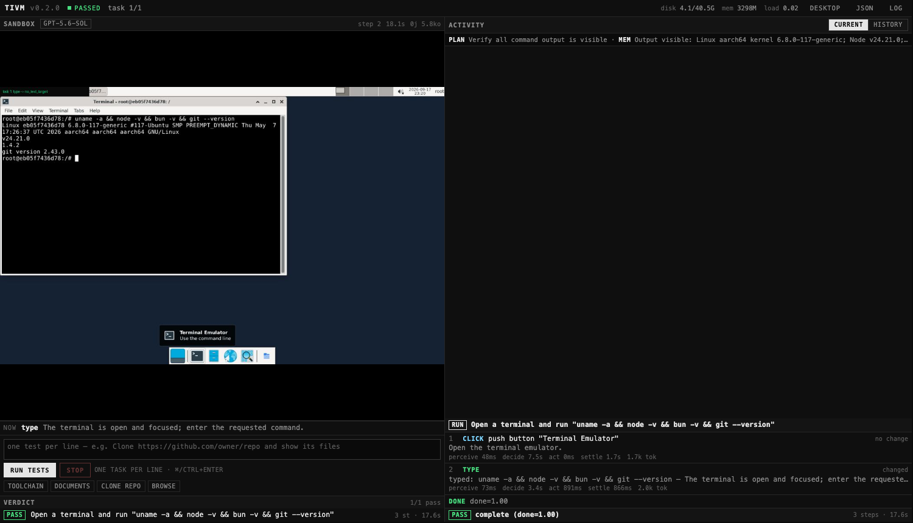

# TiVM

[](https://github.com/maskjelly/TiVM/actions/workflows/ci.yml)
[](LICENSE)

TiVM runs UI tests in a disposable Linux desktop. Give it a task, or add flows to a repository's `.tivm.yml` file. TiVM reads accessible controls and screenshots. A model chooses actions. TiVM saves verdicts, screenshots, video, and a step history. It can replay a passing flow without a new planner call. Replay checks the recorded actions and final state.

TiVM is a pre-1.0 prototype for local use and trusted repositories. Its results need review. The included todo app shows how replay works; it is not a reliability benchmark.



## Quick start

You need Docker with Compose. On macOS, install [Colima](https://github.com/abiosoft/colima) to run the Linux desktop. On Linux, use an active Docker daemon.

```sh
# macOS only
brew install colima docker docker-compose
make vm

# macOS or Linux
cp .env.example .env
# Set OPENAI_API_KEY in .env. Or set TYPESAFE_API_KEY and TIVM_PLANNER=jev.
make up
```

Open the [control panel](http://localhost:6081). Enter one task per line and select **Run tests**. For example:

```text
Open a terminal and run "uname -a"
Open the file manager and open the Documents folder
```

The [live desktop](http://localhost:6080/vnc.html?autoconnect=1&resize=scale) is on port 6080. Both ports bind to `127.0.0.1` by default.

| Command | Action |
| --- | --- |
| `make up` | Recreate and start the desktop container. |
| `make down` | Stop the container. |
| `make status` | Show the VM, containers, images, and disk use. |
| `make logs` | Follow desktop logs. |
| `make test` | Run the Python unit suite in the container. |

`make up` recreates the container. Files in the container are temporary; `runs/` and `traces/` persist on the host. Keep API keys in `.env`, which Git ignores.

## Test an app repository

TiVM can clone a repository, install and start its app, wait for it to respond, then run its flows in Firefox. The included todo app is configured in [`.tivm.yml`](.tivm.yml):

```yaml
tivm: 1
app:
  dir: examples/todo-app
  setup: []
  run: ["node server.mjs"]
  url: "http://127.0.0.1:8080"
  ready: "curl -sf http://127.0.0.1:8080/healthz"
flows:
  - name: add-todo
    steps: In the Todos app, add a todo item "write docs" and confirm it appears in the list
    expect: the item "write docs" is visible in the All list
  - name: complete-todo
    steps: Add a todo item "ship it", mark it done, open the Done filter and confirm it is listed there
    expect: the Done filter lists the completed item
```

Start that suite through the API. TiVM uses the contract flows when `tasks` is omitted:

```sh
curl -fsS -X POST http://localhost:6081/api/run \
  -H 'Content-Type: application/json' \
  -d '{"app":{"repo":"maskjelly/TiVM","ref":"main"}}'
```

If you set `TIVM_TOKEN`, add `-H 'Authorization: Bearer <your-token>'` to API requests that start, prepare, or stop runs.

To run your own task, pass `"tasks":["..."]` with the `app` object. Without a contract, TiVM can infer setup, start script, and URL from a Node app's `package.json`; add `.tivm.yml` when inference is wrong. `POST /api/prepare` checks only clone, setup, start, and readiness.

Once the suite completes, open the [run history](http://localhost:6081) in the panel or inspect `runs/<id>/report.html`. A second run can replay passing flows. TiVM falls back to the planner if replay cannot find a target or confirm the final state. Set `TIVM_REPLAY=0` to disable replay.

## Results and limits

Each task has a pass or fail verdict, a reason, and a step timeline. A failed task does not stop the other tasks. Run artifacts include `run.json`, `timeline.json`, task JSON, final screenshots, and an HTML report. TiVM also saves video when recording is enabled and `ffmpeg` is available. Artifacts can contain app data and typed text. Review them before sharing.

The default limit is 40 actions per task. Change it with `TIVM_MAX_STEPS`. TiVM can also stop when actions repeat, the screen does not change, or the planner reports a blocker. A passing verdict is model guided and can be wrong; check the report and add deterministic assertions where accuracy matters.

**Security:** app setup scripts and model chosen commands run in the desktop container. It receives the API keys from `.env`. Use only repositories and tasks you trust. The container is not a security boundary for hostile code. The hosted runner accepts trusted repositories only and rejects fork pull requests. See [Security](SECURITY.md) and [Readiness](docs/READINESS.md).

## Documentation

- [Demo walkthrough](docs/DEMO.md) — run and review the included todo app.
- [Architecture](docs/ARCHITECTURE.md) — components, API, configuration, and persistence.
- [Hosted runner](docs/HOSTED.md) — trusted repository setup and operating steps.
- [Readiness](docs/READINESS.md) — work required for a wider pilot.
- [Contributing](CONTRIBUTING.md) · [Security](SECURITY.md) · [Changelog](CHANGELOG.md) · [MIT license](LICENSE)
